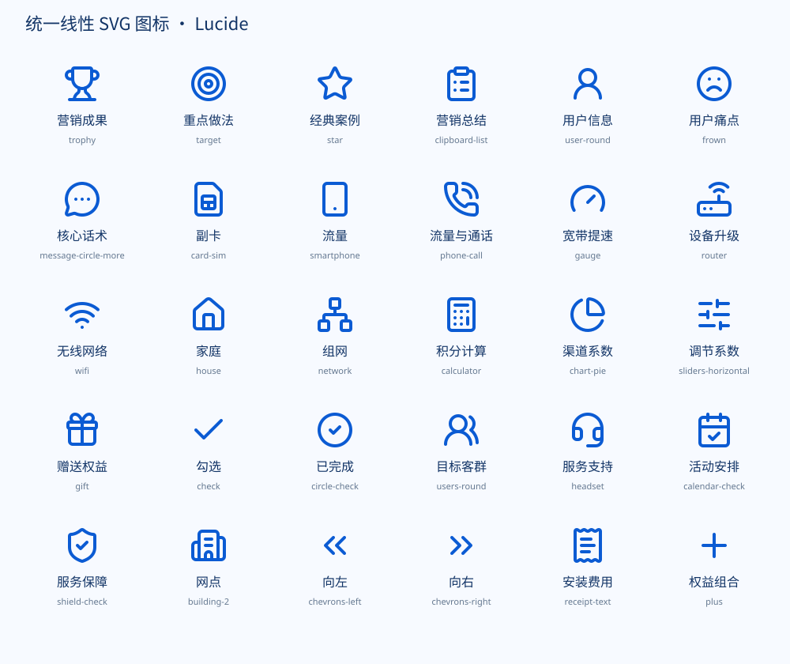

# 按图还原 PPTX

当前版本：1.3.0。通用业务图标默认使用统一的 Lucide 线性 SVG：30枚图标、统一线宽与圆角、主题换色、同组尺寸和颜色预检、PPTX SVG保留检查。保留1.2版的多段表格、数字标签与强调样式检查。详见 `CHANGELOG.md`。

图标规范与使用方法见 [统一矢量图标](references/icon-style.md)。副卡、流量与通话、宽带提速、设备升级分别使用 `card-sim`、`phone-call`、`gauge`、`router`。

把参考图中的文字、标题、图标和版式重建为图片同款样式的可编辑 PPTX。

## 安装

将 `image-style-pptx` 整个目录放到支持本地 Agent Skills 的工具的技能目录中。Codex 可放到 `~/.agents/skills/image-style-pptx/`。重新加载技能或开启新会话后，使用：

> 使用 $image-style-pptx 按这张图制作可编辑 PPTX，保留文字、标题、颜色、排版及页面比例，通用业务图标使用统一线性 SVG，提供预览。

这是一份本地技能包，不代表已在 ChatGPT 的所有设备或账户中注册。支持技能目录的工具可以加载本包；普通对话中也可以直接复制上面的指令使用。

## 内容

- `SKILL.md`：识别、重建、渲染检查及交付规则。
- `examples/red-gold-rules.json`：本次红金规则图片的文字及完整坐标。
- `scripts/render_from_spec.mjs`：使用已安装的 `@oai/artifact-tool` 输出草稿 PPTX 和 PNG。
- `scripts/prepare_reference.py`：基于 Pillow/NumPy 的确定性透视校正、证据截图裁切与来源记录。
- `scripts/check_reconstruction.py`：用 Python 标准库核对原生文字、关键数字与标签、RGB/粗体强调、原生表格及图片数，列出来源待核项。
- `references/`：JSON格式与参考图布局。
- `assets/icons/`：带来源、许可证及校验和的统一 SVG 图标集；支持按主题换色。
- `examples/unified-icons.json`：使用 `type: icon` 的完整图标展示页面。

示例的文字、规则、积分和表格可编辑。SVG 图标可以移动、缩放或替换，路径级编辑取决于应用。字体采用 Noto Sans CJK SC，未嵌入字体；在其他电脑上如发生字体替换，可安装该字体或统一替换为已有的中文字体。

拍照页中的清楚主要正文转为可编辑文本；内嵌聊天/通报截图保留为独立图片，不猜写模糊小字。照片比例与页面比例分开判断，遮挡内容不补造。当前用户的照片和截图不会自动混入本通用技能包。

脚本需要 Node.js 与 Artifact Tool，渲染之后还需按运行环境的演示文稿技能完成最终校验。详细命令见 `SKILL.md`。

技能回归检查：`python -m unittest discover -s tests -p 'test_*.py'`（Pillow、NumPy）、`node tests/preflight.mjs` 及 `node tests/icons.mjs`。预检回归不加载作者工具。正文仍需对照实际源图，并查看最终 PPTX 的实际渲染。
